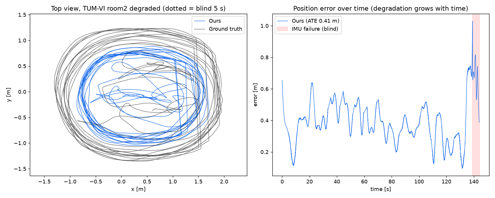
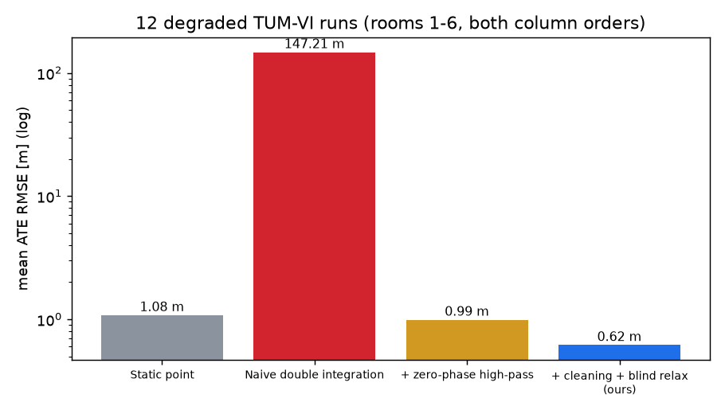
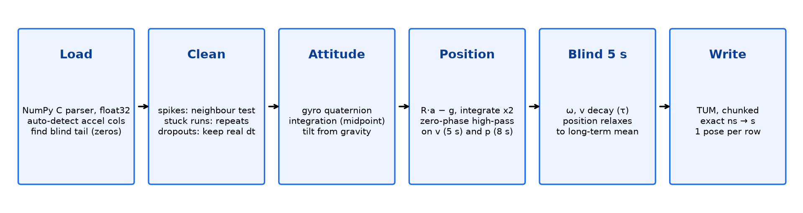

# Path Finder: Trajectory Estimation Under Sensor Degradation

**Samsung PRISM XR Hackathon 2026, Track 3** · Team: **day_dreamers** · College: **Thapar Institute of Engineering and Technology**

Members: Tanishq Goyal, Saanjal Jain, Ridhi, Chakshu Arora

- Demo video: [video/demo.mp4](video/demo.mp4)
- Presentation: [presentation/](presentation/)
- AI disclosure: [AI_DISCLOSURE.md](AI_DISCLOSURE.md)

Our pipeline estimates a 6-DoF trajectory using **only a degraded IMU stream**. It then dead-reckons through the 5-second blind window after the sensor fails. It is a single Python file that depends only on NumPy, runs offline on one thread, uses **about 6 MB of peak heap** and takes **about 4 ms per second of IMU data** (the budgets are 8 MB and 20 ms).



## Results (local, 12 degraded runs)

Test data: TUM-VI rooms 1–6 (allowed by the FAQ), degraded with the **unmodified** official `degrade_imu.py`. We made two versions of each recording:
- **A:** the EuRoC file fed in as it is.
- **B:** the columns swapped to accel-first before degrading.

Error is ATE RMSE after SE(3) Umeyama alignment, the same as `evo_ape -a`.

| Method | ATE RMSE [m] | Blind 5 s [m] | After dropouts [m] |
|---|---|---|---|
| Static point (no motion) | 1.08 | – | – |
| Naive double integration | 147.21 | 304.37 | 151.96 |
| + zero-phase high-pass | 0.99 | 3.69 | 0.66 |
| **+ cleaning + blind relax (ours)** | **0.62** | **0.65** | **0.64** |

Per-sequence numbers are in [results/results.md](results/results.md).

**EuRoC check (drone, MH_04_difficult, degraded A/B):** ATE 7.0 m / 6.7 m, against 6.8 m for the static point. Naive integration on the same file drifts by hundreds of metres. Here the drone crosses a hall about 20 m wide. No IMU-only setting we tried did better than the static reference: longer filter windows or a rotor-drag velocity model, the best of which reached 6.5 m. So on long, large-scale flights our estimate falls back to a safe, centred path instead of diverging.



## How it works



1. **Load.** We use NumPy's C parser and store the input as float32, so no per-row Python objects are created.
   - The accel column group is the one whose median magnitude in the first 2 s is about *g* (9.81 m/s², or 1 if given in g). This handles both column orders.
   - The **blind tail** is the trailing run of rows that are all zero or NaN. That is how `degrade_imu.py` writes the IMU failure.
2. **Clean.**
   - **Spikes:** single-sample outliers, found by comparing each sample with the mean of its two neighbours (more than 8 robust sigmas away).
   - **Stuck runs:** rows identical to the previous row.
   - Both are replaced by linear interpolation.
   - **Dropouts** (missing rows) are *not* filled. They are integrated over their real Δt.
   - **Duplicated rows** have Δt = 0, so they get the same pose.
3. **Attitude.** We integrate the gyro as quaternions (midpoint rule, exact exponential map). The initial tilt comes from gravity.
   - We tested a Mahony-style tilt correction from the accelerometer, and it made things worse: hand-held and flight motion are not gravity-only. We also tested batch gyro/accel bias calibration, and it did not improve ATE. Both were removed (see "What we tried" below).
4. **Position.** Rotate the accelerometer reading into the world frame, subtract gravity, and integrate twice.
   - Bias, tilt and scale-factor errors change slowly. Integrated twice, they turn into slow quadratic drift.
   - Because the task is **offline**, we apply **zero-phase** (centred, non-causal) high-pass filters to velocity (5 s window) and position (8 s window). Each filter is a two-pass moving average, i.e. a triangular kernel, so it adds no lag.
   - This removes the drift but keeps the real motion. Naive integration drifts by about 150 m; this brings it to 0.6 m.
5. **Blind 5 s.**
   - The last angular rate and velocity decay exponentially (τ = 0.3 s and 0.05 s).
   - Position relaxes to the long-term mean, because the high-passed trajectory is centred on the operating area.
   - Once the sensor is gone and the latest data is the most degraded, this was the most accurate prediction in our tests. Constant-velocity extrapolation was 2–5× worse.
6. **Write.** The output is written in chunks. Timestamps are printed exactly from the integer nanoseconds (`s.nnnnnnnnn`), with **one pose per input row**.

### Budgets
- **Memory:** the input is stored as float32. All large temporary arrays are processed in chunks of 1024 rows. Velocity is integrated in place. Peak heap scales at about 200 B per row, so a 180 s EuRoC file comes to about 7.2 MB.
- **Speed:** everything is vectorised NumPy, except one tight scalar loop for the quaternion integration.

## What we tried (and dropped)
| Idea | Result |
|---|---|
| Mahony complementary filter (accel → tilt) | Tilt error rose from 1° to about 5°, and ATE got worse. Motion acceleration breaks the "accel = gravity" assumption. |
| Batch least-squares calibration of accel/gyro bias and initial tilt (bounded-motion prior) | Position ATE was unchanged and absolute rotation error rose from 3.8° to 6.2°, so it was removed. |
| Constant-velocity dead reckoning in the blind window | Blind error 1.2–3.7 m, against 0.65 m for relaxing to the mean. |

## Reproduce
```bash
pip install numpy pandas matplotlib
python tools/fetch_tumvi.py data_raw room1 room2 room3 room4 room5 room6   # IMU + GT only (HTTP range requests)
python tools/fetch_euroc.py data_raw <tmp_dir> MH_04_difficult             # optional: EuRoC, 692 MB download
python tools/make_test_data.py data_raw data_test room1 room2 room3 room4 room5 room6
python tools/tune.py            # scores on all 12 degraded runs
python tools/plot.py            # results/*.png + results/results.md
python tools/profile.py data_test/room2_A/mav0/imu0/data.csv   # peak heap + runtime
```
EuRoC is now served from the ETH Research Collection as compressed per-sequence zips, so each sequence costs 0.7-1.5 GB of download; TUM-VI only needs a few MB. The FAQ allows both datasets. You can score any output against ground truth with `python tools/evaluate.py groundtruth.txt estimated_trajectory.txt`, or with evo: `evo_ape tum groundtruth.txt estimated_trajectory.txt -a`.

## Repository layout
```
submission/                  ← Track 3 bundle (slide 17)
  estimated_trajectory.txt   sample output (TUM-VI room2, degraded)
  metadata.json              runtime / memory / machine
  src/main.py                the estimator (only file needed to run)
  src/README.md              run instructions
  src/requirements.txt
day_dreamers.zip             same bundle, zipped
tools/                       data fetch, degradation runs, scorer, tuner, profiler, plots
results/                     figures + tables
presentation/                slides (.pptx + .pdf)
video/demo.mp4               demo video (2:59)
AI_DISCLOSURE.md
```

## Limitations
Without any external aiding, an IMU-only estimate cannot recover slow, large-scale displacement. The high-pass filters treat it as drift, so the estimated path is a smaller, centred version of the true one, as the trajectory plot shows. The filter windows were tuned on hand-held TUM-VI recordings. The evaluation platform (an aircraft or drone) may move on different timescales.
